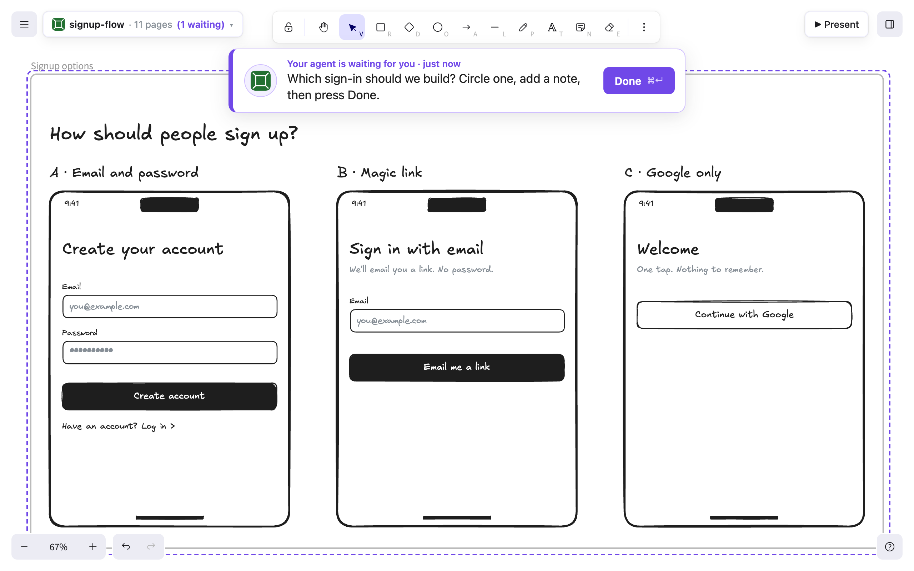
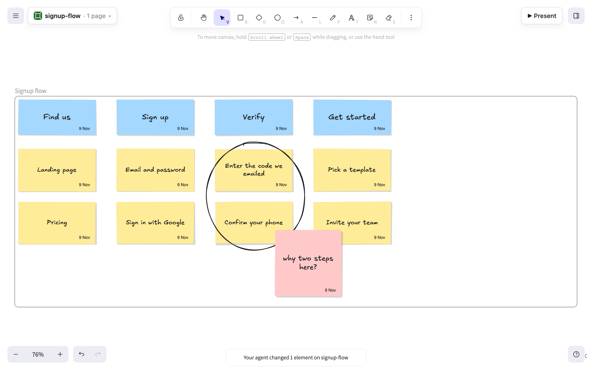
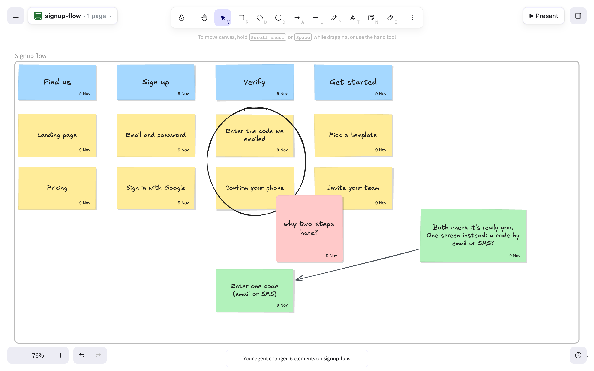
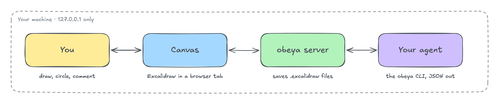
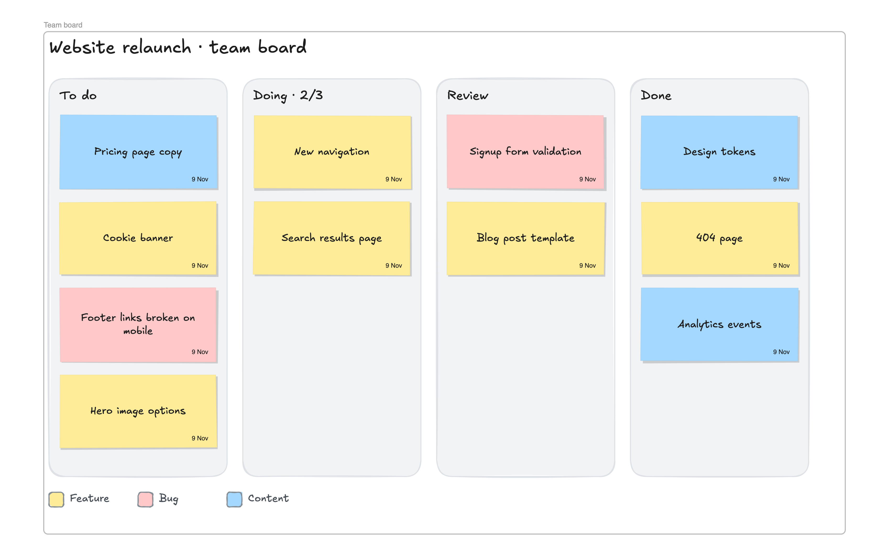
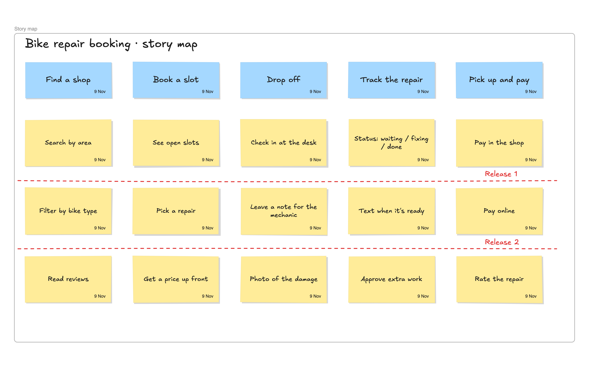
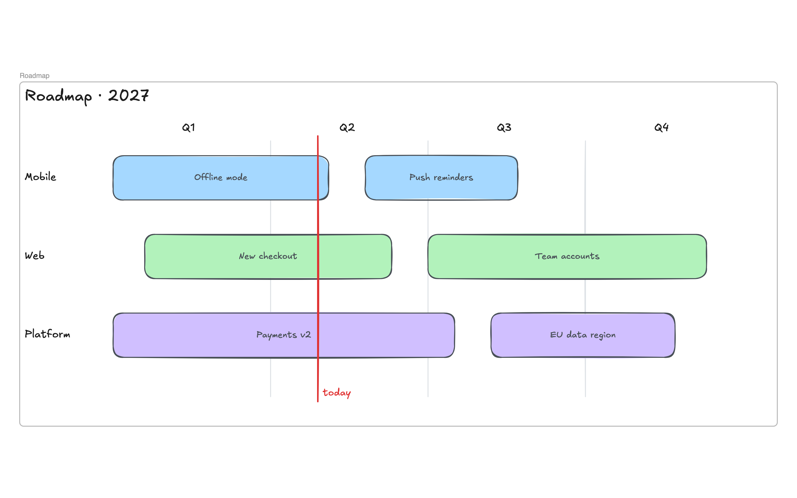
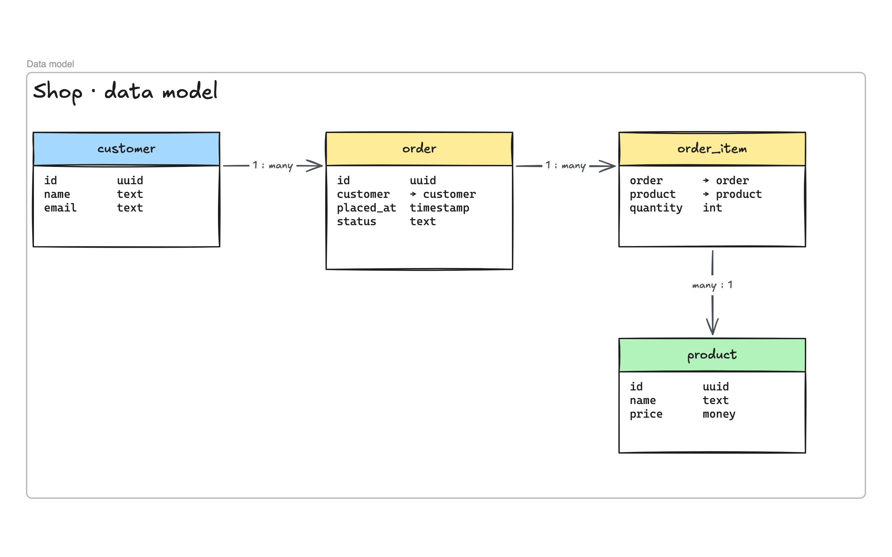
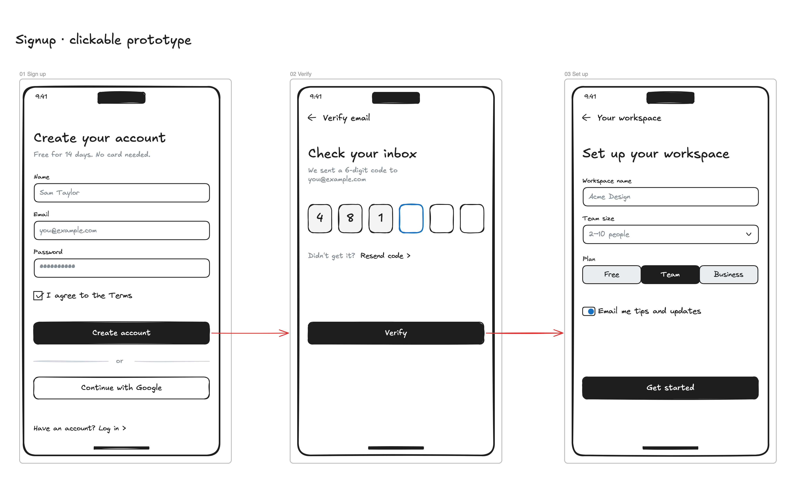
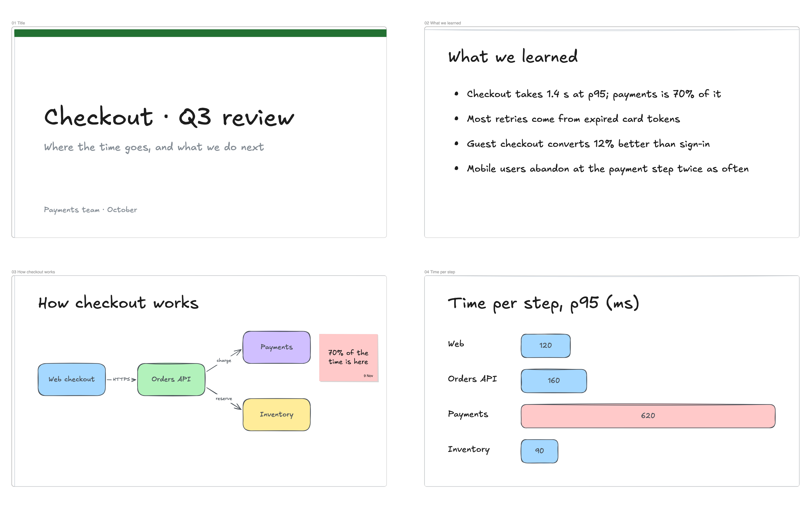

<p align="center">
  <picture>
    <source media="(prefers-color-scheme: dark)" srcset="src/page/logo-lockup-dark.svg">
    
  </picture>
</p>

<p align="center"><b>Draw with your AI agent. It sees what you circle.</b></p>

<p align="center">
  
  
  
  
</p>

**Your agent draws instead of describing.** No more ASCII diagrams in your terminal. Your agent sketches its thinking on a real Excalidraw canvas in your browser: flows, architectures, roadmaps, wireframes, slides.

**You answer by drawing.** Circle the part that's wrong, drag a card, stick a note on it, the way you would at a whiteboard. Your agent sees exactly what you did and what you pointed at, and draws its next move.

**Local only.** Pages are `.excalidraw` files, in whatever folder you keep them.

*Obeya* (大部屋, "big room") is the lean practice of a room whose walls hold the team's plans, charts and artifacts. This is that room, with an agent in it.

<table>
<tr>
<td width="33%" valign="top"></td>
<td width="33%" valign="top"></td>
<td width="33%" valign="top"></td>
</tr>
<tr>
<td valign="top"><b>1 · The agent draws</b></td>
<td valign="top"><b>2 · You circle and ask</b></td>
<td valign="top"><b>3 · It sees what you meant</b></td>
</tr>
</table>

## Install

**What you need:** Node 22.20 or later, and a browser. Chrome or Chromium is optional: with it, your agent can take screenshots and export files while no canvas tab is open.

```bash
npm i -g obeya                    # the CLI and the canvas server
npx skills add asbaker/obeya -g   # the skill: teaches your agent when and how to use obeya
```

The skill works with Claude Code, Codex, Cursor, OpenCode and more. Or paste this to your agent, and it installs both, asking first:

```text
Set up obeya: https://github.com/asbaker/obeya/blob/main/INSTALL.md
```

### Your first drawing

In any project, try:

```text
Use obeya to draw how this project fits together. Put the page in docs/obeya.
```

Your agent starts obeya in the background and opens the canvas in your browser. Keep that tab open: it's where you both draw. Pages are saved as you go.

### Update or remove

`npm update -g obeya` and `npx skills update obeya` keep both current. Removing obeya leaves your pages where they are; see [INSTALL.md](INSTALL.md#updating-and-removing).

## How it works

<p align="center"></p>

1. **Ask for a picture.** *"Map out how a request flows through this app."* Your agent draws it in your open tab, live, and points your view at it.
2. **React on the canvas.** Circle, drag, cross out, add sticky notes. No need to put it into words.
3. **Say "take a look".** Your agent reads what you changed and what each mark points at, then answers on the page: it moves cards, adds options, redraws.

Every change goes through the live editor, so your open tab stays in step. Pages are plain `.excalidraw` files: commit them, or keep them out of git.

## Example use cases

Each example was drawn by an agent through obeya (Claude Code with Claude Opus 5.5). Results depend on your agent.

<table>
<tr>
<td width="33%" valign="top"><br><b>Kanban board</b><br>Drag a card: your agent sees it move</td>
<td width="33%" valign="top"><br><b>Story map</b><br>Release lines your agent can watch</td>
<td width="33%" valign="top"><br><b>Roadmap</b><br>Lanes and a today line</td>
</tr>
<tr>
<td valign="top"><br><b>Data model</b><br>Tables and how they relate</td>
<td valign="top"><br><b>Clickable prototype</b><br>Click through it in Present mode</td>
<td valign="top"><br><b>Slides</b><br>Exported as one offline HTML file</td>
</tr>
</table>

The prototype uses components from [ecommerce mobile ui](https://github.com/excalidraw/excalidraw-libraries/blob/main/libraries/webkul/ecommerce-mobile-ui.excalidrawlib) by Webkul Software (MIT), from the public Excalidraw libraries catalogue.

## What you get

<table>
<tr>
<td width="33%" valign="top"><b>It draws instead of describing</b><br>Diagrams, flows, wireframes and slides on a real canvas, not ASCII in a terminal.</td>
<td width="33%" valign="top"><b>You answer by drawing</b><br>Circle, arrow, sticky note, drag. It reads what you did and what each mark points at.</td>
<td width="33%" valign="top"><b>It checks its own work</b><br>It screenshots the page, finds overlaps and clipped text, and fixes them before saying it's done.</td>
</tr>
<tr>
<td valign="top"><b>It shows you where to look</b><br>It moves your view to the right frame while you talk.</td>
<td valign="top"><b>Real components</b><br>Wireframe kits, cloud icons, C4 and more, from about 230 public libraries.</td>
<td valign="top"><b>Share the result</b><br>Present frame by frame with a laser pointer, or export PNG, SVG, PDF or a one-file slideshow.</td>
</tr>
</table>

## The CLI

Your agent drives obeya through a CLI that prints JSON. When you circle two cards and ask a question, this is what it sees:

```bash
$ obeya changes signup-flow
{ "result": { "changes": [
  { "op": "added", "type": "ellipse", "pointsAt": [
      { "text": "Enter the code we emailed" }, { "text": "Confirm your phone" } ] },
  { "op": "added", "type": "stickynote", "text": "why two steps here?" } ] } }
```

| Command | What it does |
|---|---|
| `obeya patch <page>` | Add, change or delete elements through the live editor |
| `obeya changes <page>` | What the person changed since the agent last looked, and what each annotation points at |
| `obeya wait <page> --ask "…"` | Ask you for something on the page; returns your changes when you press Done |
| `obeya describe <page>` | A plain-text outline of the page |
| `obeya shot <page>` | A PNG, so the agent can look at the page |
| `obeya export <page>` | PNG, SVG, PDF or an HTML slideshow |
| `obeya library` | Search, view and insert components from public libraries |

- `obeya --skill` prints the guide for the installed version (a short core; `obeya --skill <topic>` for one topic, `obeya --skill all` for everything); the installed skill points at it.
- Every command prints one compact JSON line, `{result}` or `{error: {code, message, hint}}`, holding only what an agent acts on; a success with nothing to report prints nothing.
- `obeya --help` lists the rest.

## Privacy and security

- 🔒 Listens on `127.0.0.1` only.
- 🛡️ Other websites open in your browser can't reach it (it checks `Host`, `Origin` and `Sec-Fetch-Site`).
- ⚠️ No login or token: other programs and users on the same machine can reach it, as with most local dev servers.
- 🚫 No telemetry. Pages, screenshots and exports never leave your machine.
- ⬇️ Downloads only: the pinned Excalidraw editor and fonts (from `esm.sh`), and component libraries you ask for.

## FAQ

**What does it change about working with an agent?**

obeya was planned and designed in obeya. What changed:

- **Decisions come faster.** The agent lays out the options side by side, as mockups or numbered questions. You circle one, dot-vote, or write "yes" next to it, with no long back-and-forth in chat.
- **You see it before it's built.** The page picker, the export dialog and folders were mocked up and clicked through in Present mode before any code changed.
- **Feedback lands where it belongs.** A sticky note on the draft ("skip the gif, 3 stills is fine") says exactly what you mean and where.
- **Big plans become readable.** A refactor became before/after diagrams and state machines, not a wall of text in the terminal.
- **The page is the record.** Decisions, the roadmap and a done log stay on the canvas, so the next session, or the next agent, picks up where you left off.

**Is this an official Excalidraw project?**

No. It uses the open-source Excalidraw editor (MIT) at a pinned version.

**Where do my pages go?**

Wherever you say: any folder, in or out of a project (`--dir`, or `OBEYA_DIR`; `./obeya` if you don't say). obeya adds only a hidden `.obeya/` inside it (change logs, logs, screenshots), which git ignores.

**Which agents work?**

Any agent that can run shell commands, such as Claude Code, Codex, Cursor or OpenCode. The skill installs into most of them.

## Development

With [mise](https://mise.jdx.dev) (pins Node; `mise tasks` lists the rest):

```bash
mise install && mise run setup   # Node, then playwright-core (used only by the smoke test)
mise run test                    # unit and integration tests (node --test)
mise run smoke                   # browser smoke test: needs Chrome or Chromium (CHROME_PATH=…)
mise run check                   # both
```

Without mise, on Node 22.20 or later: `npm install`, `npm test`, `npm run test:smoke`. From a checkout, run `node bin/obeya.mjs …` or `npm link`.

Made with obeya itself: the logo (`mise run brand` opens `docs/brand/logo.excalidraw`, `mise run logo` exports it) and every image here (`mise run stills` redraws the pages in `docs/readme/` and exports them; `node docs/readme/stills.mjs kanban` redraws one).

## License

MIT. See [LICENSE](LICENSE). Not affiliated with Excalidraw.
